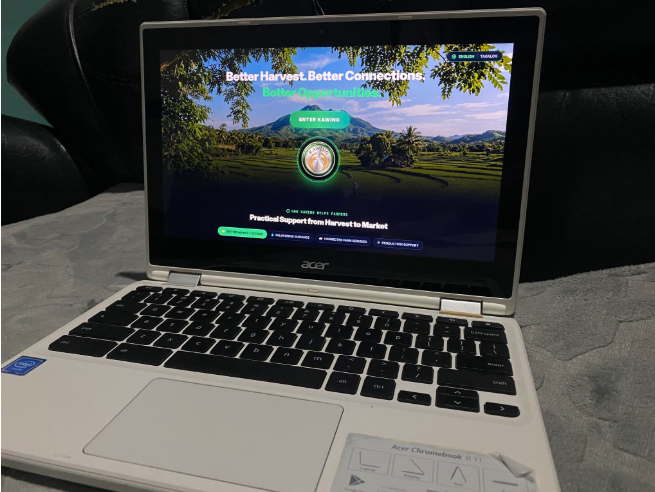
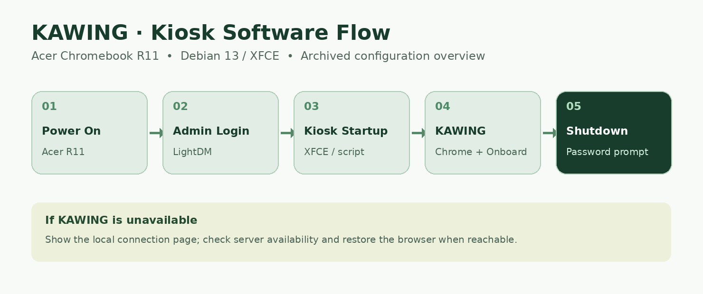

<div align="center">

# KAWING KIOSK CONFIGURATION

### From ChromeOS to Debian 13 — The Acer R11 Transformation

**An old Chromebook. A new operating system. A new purpose.**

*Firmware Modification · Linux · Touchscreen Interface · Kiosk Mode*

**Configured and documented by Catala, Orland Louise**

---

*"Sometimes the technology we need is already in our hands. We just have to give it a new purpose."*

</div>

## 🌾 Why I Built This Kiosk

This kiosk is part of my thesis project, **KAWING**, a platform intended to support farmers. Not every farmer in the Philippines has easy access to a personal computer or smartphone, so I wanted to provide a **shared touchscreen device** that could serve as another way to use KAWING.

But I faced a similar challenge myself: **I had a limited budget**. Buying a dedicated kiosk was not practical, so I repurposed an **Acer Chromebook R11 (CB5-132T-C9KK)** instead.

The [CAD folder](../CAD/README.md) shows how I redesigned the physical laptop. **This folder tells the other half of the story:** how I modified its firmware, installed Linux, and configured the device to operate as a KAWING kiosk.

> The goal was not to build the most expensive kiosk. It was to make KAWING more accessible using hardware I already had.

---

## 🔄 The Software Transformation

<div align="center">

**CHROMEBOOK R11 → WRITE PROTECTION REMOVAL → FIRMWARE UPDATE → DEBIAN 13 → TOUCHSCREEN KIOSK → KAWING**

</div>

### 01 — Starting with the Acer Chromebook R11

The original device was an **Acer Chromebook R11**, a convertible laptop equipped with an 11.6-inch touchscreen. Its original operating system was **ChromeOS**.

<div align="center">
  

  <p><em>Fig. 1 — Original visualization of the Acer Chromebook R11 (Showing the first landing page of KAWING).</em></p>
</div>

### 02 — Removing the Firmware Write-Protection Screw

The first hardware modification was opening the laptop and removing its **firmware write-protection screw**. The R11's **CYAN** board uses a physical write-protection screw, so removing it made the subsequent firmware modification possible.

<div align="center">
  

  <p><em>Fig. 2 — Reference photo of the CYAN board's firmware write-protection screw (not my own photo).</em></p>
  <sub>Source: <a href="https://docs.mrchromebox.tech/images/wp/cyan_wp.jpg">MrChromebox — CYAN write-protection screw photo</a></sub>
</div>

For another Acer R11 teardown reference, see [Sudaraka’s Chromebook R11 guide](https://sudaraka.org/how-to/chromebook-r11-archlinux-installation-guide/).

### 03 — Changing the Firmware in the Terminal

With the physical write protection removed, I used the **MrChromebox Firmware Utility Script** to change the Chromebook's stock firmware so a standard Linux distribution could boot.

The official command documented by MrChromebox is:

```bash
cd; curl -LOf https://mrchromebox.tech/firmware-util.sh && sudo bash firmware-util.sh
```

<div align="center">
  

  <p><em>Fig. 3 — Example MrChromebox firmware utility menu. This screenshot shows a different Acer Chromebook (C720), not my R11, and is included only to illustrate the terminal interface.</em></p>
  <sub>Source: <a href="https://www.ifixit.com/Guide/How+to+convert+a+generic+Chromebook+to+Linux+OS/108259">iFixit — How to convert a generic Chromebook to Linux OS</a></sub>
</div>

For accurate instructions and compatible menu options, see the [official MrChromebox firmware guide](https://docs.mrchromebox.tech/docs/getting-started.html). Flashing firmware can prevent a device from booting if the wrong firmware is used; back up the original firmware before proceeding.

### 04 — Installing Debian 13 (Trixie)

After modifying the firmware, I installed **Debian 13 (Trixie)** to replace ChromeOS. The saved device scan identifies **Debian 13**, **XFCE desktop**, **X11**, and **MrChromebox firmware**.

<div align="center">
  

  <p><em>Fig. 4 — Debian 13 installer reference screenshot (from the internet, not a screenshot of my own installation).</em></p>
  <sub>Source: <a href="https://www.linuxtechi.com/how-to-install-debian-13-step-by-step/">LinuxTechi — How to install Debian 13 step by step</a></sub>
</div>

### Debian ISO — What I Used

I replaced ChromeOS with **Debian GNU/Linux 13 (Trixie), 64-bit (amd64)**, using the **XFCE desktop environment**. This is the operating system installed on my Acer Chromebook R11 kiosk, as confirmed by my saved device configuration.

- **Operating system used:** Debian GNU/Linux 13 (Trixie)
- **Architecture:** 64-bit (`amd64` / `x86_64`)
- **Desktop environment:** XFCE
- **Firmware:** MrChromebox UEFI firmware
- **Official Debian 13 ISO downloads:** [Debian 13 installation images](https://www.debian.org/releases/trixie/debian-installer/)
- **Official installation instructions:** [Debian 13 installation guide](https://www.debian.org/releases/trixie/amd64/index.en.html)

> **Installer note:** My saved configuration confirms Debian 13 and its 64-bit architecture, but does not record the exact installer ISO filename or point release I originally used. The official link above provides Debian 13 installation media, **not a verified copy of my original installer**. The ISO is linked rather than included in this repository.

Debian gave me more control over startup behavior, the touchscreen keyboard, browser kiosk mode, and power management. **Firmware** determines how the Chromebook starts; **Debian 13** is the operating system running afterward.

### 05 — Keeping the Administrator Login

The kiosk is not designed to log in automatically when powered on.

Instead, the administrator logs in first. Once the desktop session starts, the KAWING kiosk launches automatically through the configured startup entry.

**Startup sequence:**

```text
Power on
   ↓
Administrator login
   ↓
XFCE session starts
   ↓
KAWING startup script runs
   ↓
Onboard keyboard + Chrome kiosk mode
```

This keeps administrator sign-in as an intentional part of the startup workflow.

### 06 — Replacing the Desktop Keyboard with a Phone-Style Keyboard

Because the kiosk is meant to be operated through its touchscreen, I installed **Onboard**, a Linux on-screen keyboard, and customized its layout to resemble a phone keyboard.

The uploaded configuration includes a custom layout called `KAWING-Phone`, with letter, number, symbol, and emoji-related layout files.

I also configured the keyboard to appear when users tap supported text-entry fields in Google Chrome. This required a Chrome accessibility setting and additional keyboard handling for the shutdown dialog.

The result is an interface designed for touch input rather than a physical keyboard.

### 07 — Launching KAWING in Kiosk Mode

I configured **Google Chrome** to run in fullscreen kiosk mode, hiding the usual browser interface so the screen focuses on KAWING.

The archived kiosk controller also:

- Hides the XFCE desktop panel and ordinary desktop icons while in kiosk mode.
- Hides the mouse cursor when it is not needed.
- Prevents ordinary screen blanking during operation.
- Checks configured KAWING servers for availability.
- Displays a local connecting/offline page if the servers cannot be reached.
- Restarts the kiosk browser when it detects that its Chrome process has closed.

**KAWING website:** [kawingph.com](https://kawingph.com/)

> **Configuration note:** The uploaded November 10, 2026 snapshot launches KAWING through local network server addresses rather than directly opening `kawingph.com`. The public website and the saved kiosk configuration are therefore not necessarily the same deployment.

### 08 — Adding Password-Confirmed Shutdown

I wanted shutting down the kiosk to require administrator confirmation.

A custom **KAWING Secure Shutdown** dialog asks for a username and password before attempting to power off the device. It uses the system's authentication mechanism to check the credentials.

The saved handoff records successful user tests of the key behaviors:

- Incorrect credentials do not authorize shutdown.
- Correct credentials allow the shutdown action.
- **Cancel** closes the dialog and returns to KAWING.
- The phone-style on-screen keyboard works with the username and password fields.
- Cancel also hides the keyboard opened for the shutdown dialog.

This adds an administrator-confirmation step to the intended shutdown workflow. It should not be treated as proof that all other power-off or kiosk-exit methods are blocked.

---

## 📁 Explore the Documentation and Configuration Files

Everything in this package is organized into these folders and documents:

| File or folder | What you'll find |
|:--|:--|
| [Images/](Images/README.md) | Original system-flow diagram and links to credited internet reference photos |
| [Scripts/](Scripts/README.md) | Historical KAWING kiosk launch, maintenance, offline page, shutdown interface and charge-limit scripts |
| [Keyboard/](Keyboard/README.md) | KAWING-Phone Onboard layout files and keyboard settings |
| [Configurations/](Configurations/README.md) | LightDM, XFCE, desktop launchers, autostart, and systemd service configurations |
| [INSTALLATION.md](INSTALLATION.md) | Firmware modification and Debian 13 installation overview, including official ISO link |
| [SYSTEM-FLOW.md](SYSTEM-FLOW.md) | Login, KAWING browser startup, offline handling, secure shutdown and maintenance flow |
| [CREDITS.md](CREDITS.md) | Original work, third-party photographs, documentation, and license notes |
| [DEBIAN-13-ISO.md](DEBIAN-13-ISO.md) | Which Debian version I used and where to obtain official installation media |

<div align="center">
  
  <p><em>Original workflow illustration based on the archived configuration (not a screenshot of the physical kiosk).</em></p>
</div>

> [!CAUTION]
> **For public GitHub use:** The included configuration files are archived examples. Private IP addresses from the original kiosk script have been replaced with nonfunctional sample hostnames. Administrator-specific settings, kiosk escape restrictions, and power permissions require security review before use in a public kiosk.

---

## ⚙️ System Overview

| Part | Configuration |
|:--|:--|
| Original laptop | Acer Chromebook R11 CB5-132T-C9KK |
| Hardware board | CYAN / Quanta ZHR |
| Original OS | ChromeOS |
| Replacement OS | Debian 13 (Trixie) |
| Firmware | MrChromebox (identified in saved scan) |
| Desktop environment | XFCE (X11) |
| Kiosk browser | Google Chrome |
| Touchscreen keyboard | Onboard — custom KAWING-Phone layout |
| Startup | Administrator login, then automatic kiosk launch |
| Shutdown | Custom username/password confirmation |
| KAWING platform | [kawingph.com](https://kawingph.com/) |

## 🧩 Additional Configurations

**Offline handling:** The system can display a local KAWING connection page when its configured servers are unavailable.

**Maintenance mode:** The saved scripts include a way to stop kiosk mode and restore the XFCE desktop for maintenance. Its security restrictions still need review before public deployment.

**Battery management:** A saved service and script attempt to stop charging at **80%** and resume at **75%**. The uploaded scan did not confirm that this service was running successfully on the physical device.

---

## 📂 What Was Reviewed

This documentation is based on the **KIOSK CONFIGURATION** handoff files saved on **November 10, 2026**. They include the kiosk startup and shutdown scripts, desktop launchers, LightDM configuration, Onboard layout files, package status, and system scan notes.

This README describes the setup and design choices. This package also includes a **historical, privacy-reviewed configuration snapshot** and a step-by-step explanation. The archived scripts are shared for study, not as a security-audited turnkey deployment.

> [!NOTE]
> **Verification and security**
>
> The source handoff reports that the Chrome kiosk, custom keyboard, and shutdown confirmation worked in user tests. However, full cold-boot, touch-only public operation, session privacy, kiosk escape protection, and other security checks were not yet fully verified in that snapshot. Some configuration and device details may have changed since then.
>
> Avoid publishing administrator passwords, private keys, browser profiles, internal network details, or raw device logs.

---

## 🔗 Explore the Physical Design

This folder documents the **operating system and software** part of the transformation.

To see how the laptop was dismantled, rearranged, and assembled into a custom kiosk enclosure, visit:

### [📐 Acer R11 — CAD Design and Assembly](../CAD/README.md)

---

## 👨‍💻 Behind the Project

**Catala, Orland Louise**

*Student Developer · Hardware Repurposing · Linux Kiosk Configuration*

I documented this project to show how an existing Chromebook can be reused as an alternative access device for **KAWING**. It is a practical attempt to address limited resources—both for the farmers the platform is intended to serve and for the student building it.

**GitHub:** [LouiseCatala](https://github.com/LouiseCatala)

---

## ⚖️ Copyright & Usage

**© 2026 Catala, Orland Louise. All rights reserved** for my original writing, customizations, and project materials.

You may view and learn from this documentation. Reproducing or redistributing my original project materials requires permission, unless another license applies. Third-party images, software, trademarks, and source materials remain subject to their respective licenses and owners' rights. This notice does not replace the licenses that apply to Debian, Onboard, Chrome, or any other third-party software.

**External references:**

- [MrChromebox — Supported Devices (Acer Chromebook R11 / CYAN)](https://docs.mrchromebox.tech/docs/supported-devices)
- [MrChromebox — CYAN write-protect screw photo](https://docs.mrchromebox.tech/images/wp/cyan_wp.jpg)
- [Sudaraka — Chromebook R11 installation guide and internal photos](https://sudaraka.org/how-to/chromebook-r11-archlinux-installation-guide/)
- [iFixit — Example MrChromebox firmware utility menu (different Acer model)](https://www.ifixit.com/Guide/How+to+convert+a+generic+Chromebook+to+Linux+OS/108259)
- [LinuxTechi — Debian 13 installation screenshot](https://www.linuxtechi.com/how-to-install-debian-13-step-by-step/)
- [Debian — Official Debian 13 installation instructions](https://www.debian.org/releases/stable/amd64/index.en.html)

> The external images are credited as references. Check reuse permissions before redistributing copies of third-party photographs.

---

<div align="center">

## A SECOND LIFE FOR AN OLD LAPTOP.

*One device. A different purpose. A new beginning.*

**Created and visualized by Catala, Orland Louise**

**Built with purpose, not a big budget.**

---

[← Back to Main Repository](../README.md)

</div>
