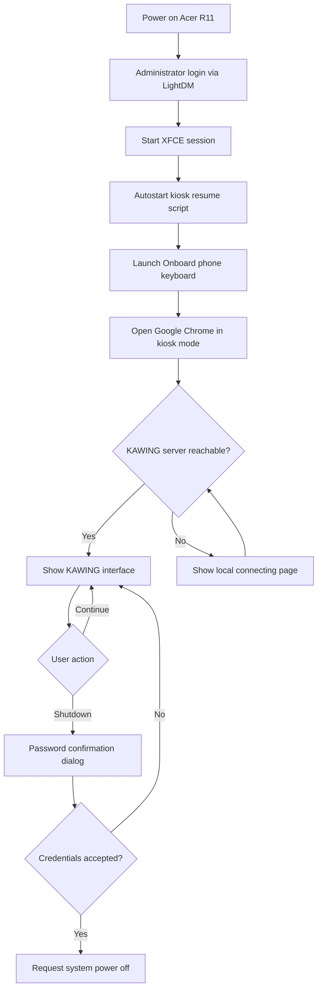

# KAWING Kiosk — System Flow

This describes the software behavior visible in the **November 10, 2026** configuration snapshot. It is a documented design flow, not a penetration-test or production certification.

## Startup

The LightDM login manager prompts for an administrator account. XFCE loads and runs the KAWING autostart desktop entry, which starts the kiosk controller. The controller starts **Onboard**, manages the Chrome kiosk instance and checks the configured KAWING servers.

## Internet / local-server unavailable

A `curl` loop checks the server endpoints every five seconds. When they cannot be reached, the script opens the local `kawing-offline.html` page. It returns to KAWING when a reachable endpoint appears. The published archive contains **placeholder `.example` hostnames**, not the private local IP addresses originally recorded.

## Secure shutdown interface

The user may open a custom shutdown dialog. The input is checked via PAM; successful authentication causes a `systemctl poweroff` request. **Cancel** closes the window; it does not power off the device.

## Maintenance and return

The `kawing-maintenance.sh` script restores the normal XFCE desktop and stops the kiosk process. The `kawing-resume.sh` script resumes kiosk operation.

## Cautions

- A kiosk-style browser window does not by itself guarantee a secure public kiosk.
- Access restrictions and shutdown permissions need validation on the actual machine.
- The current browser URL in the original archive was a **local development/server URL**, not the public domain `kawingph.com`.
- The battery threshold service may not work if the Chromebook kernel does not expose the expected sysfs interfaces.
